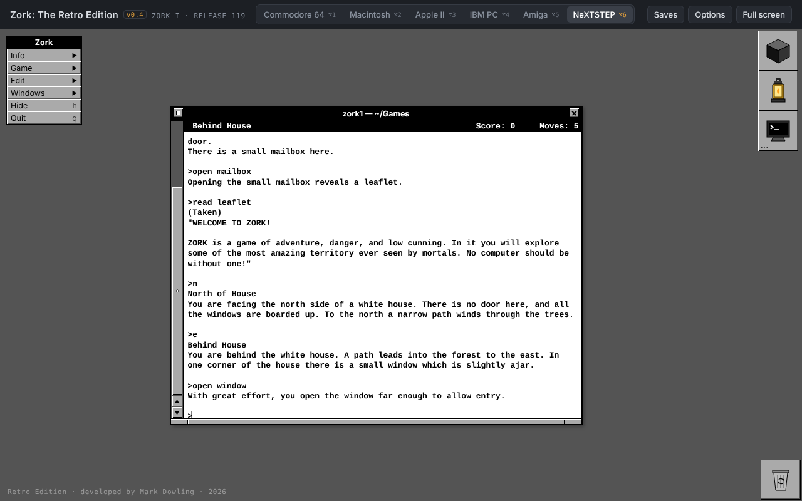
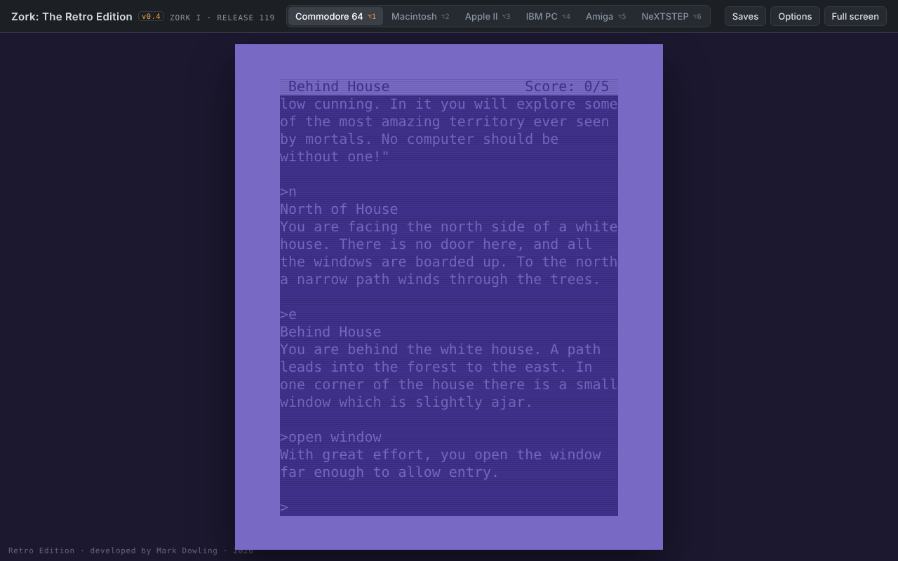
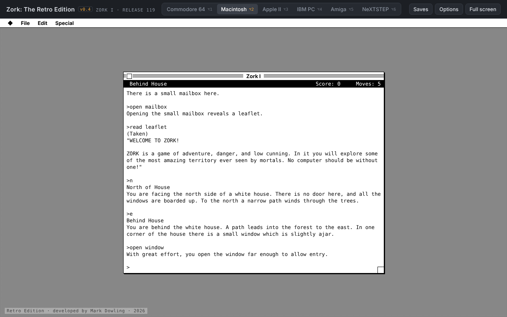
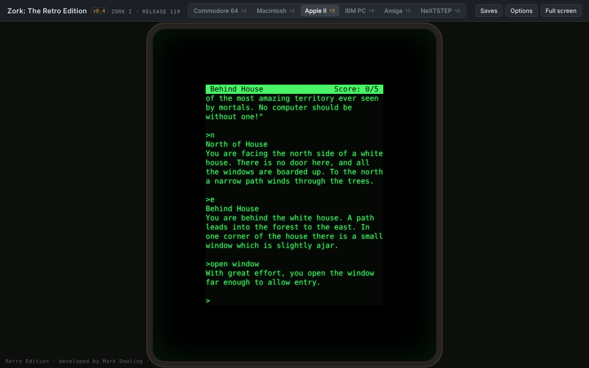
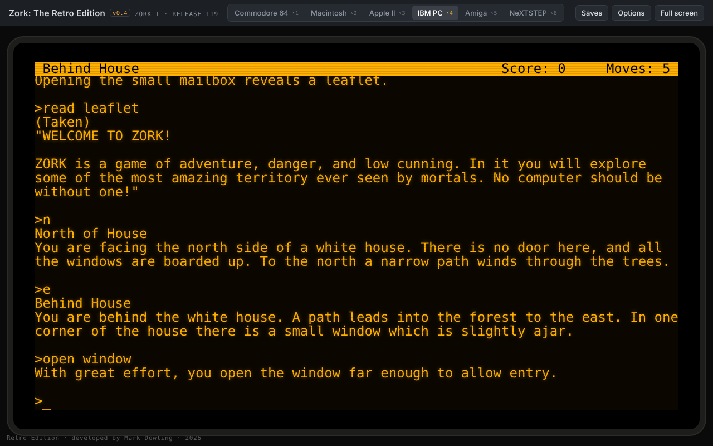
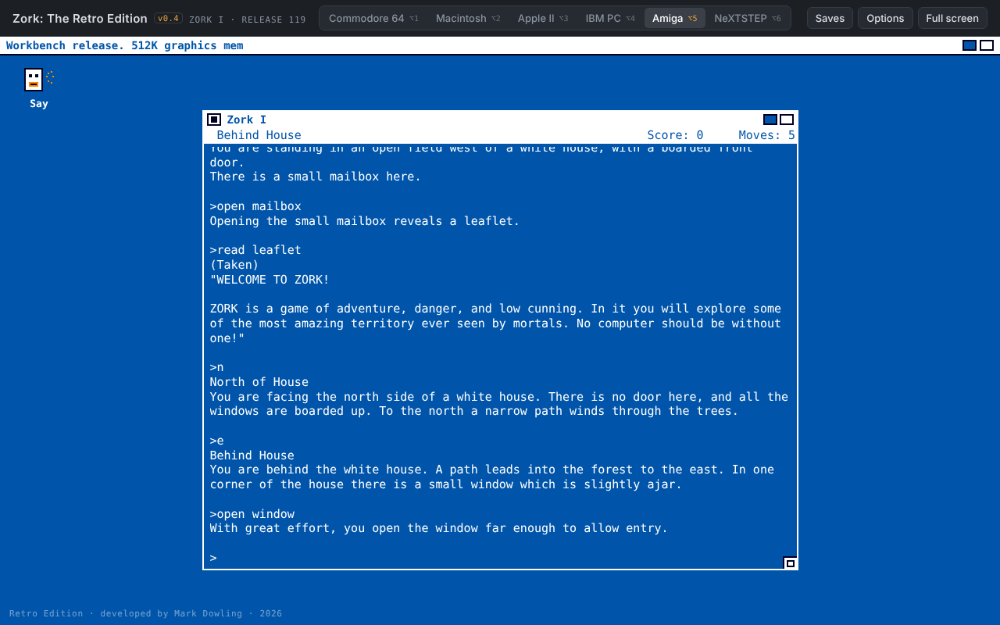

# Zork: The Retro Edition

**Version 0.4 · November 2026**

Play Infocom's *Zork I: The Great Underground Empire* in your browser, dressed up as six classic computers of the 1980s and 90s. One self-contained HTML file, about 120 KB, with no install and no internet needed once it's loaded.

**▶ Play it here:** https://markdowlingsretros.github.io/zork-retro-edition/

> An unofficial fan project. Not affiliated with or endorsed by Microsoft, Activision or Infocom. Zork is a trademark of its owner.

## Six machines, one game

Switch machines at any time from the bar at the top, or with **Option/Alt + 1–6**. Your game carries on exactly where it was.

| | | |
|---|---|---|
|  **Commodore 64** |  **Macintosh** |  **Apple II** |
|  **IBM PC** |  **Amiga** |  **NeXTSTEP** |

The machine looks are AI-made impressions built for fun. They are not the original systems or software, and the makers of those machines have nothing to do with this project.

## How to play

- **Online:** open the link above.
- **Offline:** download `index.html` and double-click it. It works in Safari 16.4, Chrome 80, Firefox 113 or newer.

Type commands and press Return. New to Zork? Try `open mailbox`, `read leaflet`, then head round the house.

**Keys**

| Key | Does |
|---|---|
| Up / Down arrows | Previous commands |
| Page Up / Page Down | Scroll back through the story |
| Option/Alt + 1–6 | Switch machine |
| Option/Alt + Enter | Full screen |

## Features

- **The real game:** Zork I, Release 119, running on a Z-machine interpreter written for this project.
- **Saving:** type `SAVE` or `RESTORE` and pick a position from 1 to 5. The **Saves** panel can load, export and import positions. Exports are standard Quetzal files that other Z-machine interpreters, such as Frotz, can open.
- **Auto-resume:** close the page and you pick up where you left off.
- **Transcripts:** **Saves → Save transcript** downloads your whole game as a text file.
- **Resizable windows** on the Macintosh, Amiga and NeXTSTEP desktops, remembered per machine.
- **Options:** sound effects, a disk-loading boot sequence, CRT scanlines, amber or green IBM phosphor, an Apple II 80-column card, and a fixed random seed for repeatable thief and combat.
- **Extras:** keep an eye out for the easter eggs, both the obvious ones and the not so obvious.

Saves and the auto-resume are stored in your browser only. Use **Export** to keep a copy.

## Limitations

- Plays **Zork I**. The player handles the early Infocom format (version 3) used by the Zork trilogy; later Infocom games such as *Trinity* will not run.
- Fonts load from Google Fonts when online. Offline, each machine falls back to a built-in font.

## Credits

- **Zork I** by Infocom: Tim Anderson, Marc Blank, Bruce Daniels and Dave Lebling.
- **Zork I source and story file** from [historicalsource/zork1](https://github.com/historicalsource/zork1), released by Microsoft under the MIT licence in 2025. See [`LICENSE-Zork.txt`](LICENSE-Zork.txt).
- **Fonts:** IBM Plex, Press Start 2P, VT323 and Sixtyfour, via Google Fonts (SIL Open Font Licence).
- **Developed by Mark Dowling**, Berwick, Melbourne, Australia, November 2026. Built with Claude, with ChatGPT on the initial spec and quality checks.

## Licence

- **Zork I** (the story file inside `index.html`) is © Microsoft, under the MIT licence in [`LICENSE-Zork.txt`](LICENSE-Zork.txt).
- **Everything else** (the player, machine designs and extras) was developed by Mark Dowling. Hacks and remixes are welcome; please keep the credit with any version you share.
- "Zork" is a trademark of its owner and is not covered by either of the above.
